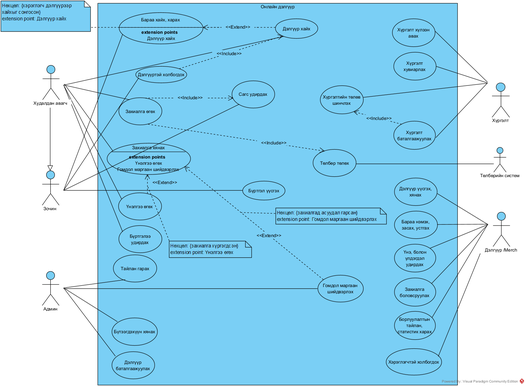

# Онлайн дэлгүүр — Flutter прототип

`docs/UseCase.png` use case диаграмд тулгуурласан олон дэлгүүртэй (marketplace) онлайн дэлгүүрийн мобайл аппын прототип.
Өгөгдөл нь санах ойд хадгалагдах жишээ өгөгдөл тул сервер шаардлагагүй.



## Ажиллуулах

```bash
cd online_shop
flutter pub get
flutter run            # Android / iOS төхөөрөмж эсвэл эмулятор
flutter run -d chrome  # браузерт
flutter test
```

Нэвтрэх дэлгэц дээр дүрээ сонгоод жишээ хэрэглэгчээр орно.

## Актор ба use case-ийн хэрэгжилт

| Актор | Use case | Дэлгэц |
|---|---|---|
| Зочин | Бараа хайх, харах (+ Дэлгүүр хайх) | Бараа, Дэлгүүр таб |
| Зочин | Бүртгэл үүсгэх | Бүртгүүлэх таб / нэвтрэх дэлгэц |
| Худалдан авагч (Зочноос өвлөнө) | Сагс удирдах, Захиалга өгөх | Сагс → Захиалга баталгаажуулах |
| Худалдан авагч | Төлбөр төлөх (Төлбөрийн систем) | Төлбөрийн системийн цонх (дуурайлга) |
| Худалдан авагч | Захиалга хянах (+ Үнэлгээ өгөх, Гомдол мэдүүлэх) | Захиалга → дэлгэрэнгүй |
| Худалдан авагч | Дэлгүүртэй холбогдох | Барааны / дэлгүүрийн хуудас → Чат |
| Худалдан авагч | Бүртгэлээ удирдах | Профайл таб |
| Дэлгүүр /Merch | Дэлгүүр үүсгэх, хянах | Дэлгүүр таб |
| Дэлгүүр /Merch | Бараа нэмэх, засах, устгах; Үнэ болон урамшуулал удирдах | Бараа таб |
| Дэлгүүр /Merch | Захиалга боловсруулах | Захиалга таб |
| Дэлгүүр /Merch | Борлуулалтын тайлан, статистик харах | Тайлан таб |
| Дэлгүүр /Merch | Хэрэглэгчтэй холбогдох | Чат таб |
| Хүргэлт | Хүргэлт хүлээн авах | Шинэ хүргэлт таб |
| Хүргэлт | Хүргэлт хуваарилах, Хүргэлтийн төлөв шинэчлэх, Хүргэлт баталгаажуулах | Миний хүргэлт таб |
| Админ | Тайлан харах | Тайлан таб |
| Админ | Бүтээгдэхүүн хянах | Бүтээгдэхүүн таб |
| Админ | Дэлгүүр баталгаажуулах | Дэлгүүр таб |
| Админ | Гомдол шийдвэрлэх | Гомдол таб |

## Захиалгын урсгал

Төлбөр төлөгдсөн → Дэлгүүр боловсруулж байна → Хүргэлтэд бэлэн → Хүргэгч хүлээн авсан → Хүргэлт хуваарилагдсан → Замд явж байна → Хүргэгдсэн

## Бүтэц

```
online_shop/lib/
  main.dart                 # апп, дүрээр чиглүүлэх
  models.dart               # өгөгдлийн загварууд
  app_state.dart            # төлөв + use case бүрийн логик + жишээ өгөгдөл
  widgets/common.dart       # дахин ашиглах widget, чат
  screens/
    login_screen.dart       # дүр сонгох, бүртгэл үүсгэх
    buyer_screens.dart      # Зочин, Худалдан авагч
    merchant_screens.dart   # Дэлгүүр /Merch
    courier_screens.dart    # Хүргэлт
    admin_screens.dart      # Админ
```
